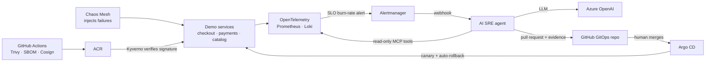

# AI SRE Agent for AKS

A Kubernetes platform that **detects** its own incidents, uses an **AI agent** to investigate
and propose a fix as a **pull request**, and rolls the fix out **safely** after a human approves.

> Personal project. Status of each part is listed below and only marked done once verified.



## Components and status

| # | Component | Tools | Status |
|---|---|---|---|
| 1 | AI SRE agent, MCP server, guardrails, evals | Python, FastAPI, Azure OpenAI, MCP, pytest | **Built, 23 tests passing**; LLM accuracy not yet measured |
| 2 | Platform infrastructure | Terraform, AKS (Cilium, workload identity), Key Vault, ACR | Built and statically validated earlier; to be moved into `infra/` |
| 3 | GitOps delivery | Argo CD, Argo Rollouts (canary + Prometheus analysis) | Planned |
| 4 | Supply chain security | GitHub Actions, Trivy, Syft SBOM, Cosign keyless signing, Kyverno | Planned |
| 5 | Demo services | Python, OpenTelemetry, fault-injection flags | Planned |
| 6 | Observability and SLOs | Prometheus, Grafana, Loki, multi-window burn-rate alerts | Planned |
| 7 | Chaos experiments | Chaos Mesh: bad deploy, OOM, CPU spike, dependency outage | Planned |
| 8 | End-to-end demo and write-up | Recorded run: failure → alert → PR → merge → recovery | Planned |

## Repository layout

```
agent/        the AI SRE agent (done)
infra/        Terraform for AKS and supporting services
gitops/       Argo CD apps and per-service values the agent edits
services/     demo microservices
chaos/        Chaos Mesh experiments matching the eval scenarios
.github/      CI: tests, image build, scan, sign
```
