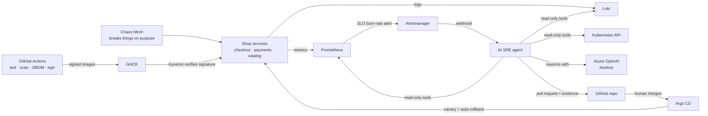

# AI SRE Agent for AKS

A Kubernetes platform on Azure where an **AI agent investigates production incidents** and
proposes the fix as a **pull request**. A human approves it, and the fix rolls out **safely as a canary**.

> Personal project. Code complete and tested locally (see "What has been verified"). Deployment
> status is tracked in the table at the bottom.



## What each part does

| Folder | What it is | Main tools |
|---|---|---|
| `agent/` | The AI agent: investigates alerts with 5 read-only tools, checks its own answer with guardrails, opens a PR | Python, FastAPI, Azure OpenAI, MCP |
| `services/shop/` | Demo shop the agent watches, with switches to break it | Python, FastAPI, Prometheus metrics |
| `infra/` | Azure resources | Terraform, AKS (Cilium, workload identity), Azure OpenAI |
| `gitops/` | Everything that runs in the cluster, deployed by Argo CD from this repo | Argo CD, Helm, Argo Rollouts, Prometheus, Loki, Kyverno |
| `chaos/` | Experiments that cause each incident type | Chaos Mesh |
| `.github/workflows/` | CI (tests, validation) and image build (scan, SBOM, keyless signing) | GitHub Actions, Trivy, Syft, Cosign |
| `scripts/` | One-command deploy, incidents, teardown from Azure Cloud Shell | Bash, Azure CLI |

## Run it

**Once, on GitHub:**
1. Push this repo. The **build** workflow creates and signs the images (about 5-8 minutes; watch the Actions tab).
2. Make the two packages public: your profile → **Packages** → `shop` and `sre-agent` → **Package settings** → **Change visibility** → **Public**.
3. Optional: create a fine-grained token (Settings → Developer settings → Fine-grained tokens) for this repo only, with **Contents** and **Pull requests** set to *Read and write*. Without it, the agent runs in dry-run mode.

**Each session, in Azure Cloud Shell (Bash):**
```bash
git clone https://github.com/srujanachireddy/aks-ai-sre-agent.git && cd aks-ai-sre-agent
./scripts/up.sh                       # about 30 minutes the first time
./scripts/ui.sh <your-laptop-ip>      # Argo CD, Grafana and the agent, open only to your laptop
./scripts/incident.sh payments        # break something
./scripts/incident.sh agent           # read what the agent concluded (5-10 minutes later)
./scripts/down.sh                     # delete everything that costs money
```

**Cost:** about $0.40/hour while running (2 small nodes, load balancers, a few cents of AI tokens). Always finish with `down.sh`.

## Incidents you can cause

| Command | What breaks | Alert | Correct agent answer |
|---|---|---|---|
| `incident.sh payments` | payments goes down | ShopErrorBudgetBurn on **checkout** | dependency failure → escalate, naming payments |
| `incident.sh memory` | catalog is OOMKilled repeatedly | ShopPodsRestarting | memory exhaustion → raise memory limit |
| `incident.sh cpu` | checkout CPU saturated, HPA at max | ShopLatencyHigh | capacity → raise max replicas |
| `incident.sh bad-deploy` | release v1.4.0 has a bug | caught by canary analysis, or ShopErrorBudgetBurn | bad deploy → roll back to v1.3.2 |

## What has been verified

| Check | Result |
|---|---|
| Agent unit tests (loop, guardrails, redaction, webhook, MCP, real GitOps files) | 30 passing |
| Shop tests, plus all 3 services run together with live traffic and injected failures | 8 passing; failures look as expected |
| Agent ↔ Azure OpenAI request/response, against a mock endpoint | correct URL, tools, parsing |
| Rule-based baseline on 5 recorded incidents | 2/5 correct (40%) |
| Terraform | `validate` passes |
| Helm charts rendered → Kubernetes + CRD schemas (strict) | 37/37 objects valid |
| Alert rules (`promtool test rules`) | fire 3 minutes after a 23% error rate; silent at 0.2% |
| Every PromQL query (agent, dashboard, canary) | 19/19 valid |
| Image-signing policy with the Kyverno 1.19 CLI | compiles and evaluates |
| Chaos experiments against Chaos Mesh 2.8.4 CRDs | valid |
| Workflows (actionlint), scripts (shellcheck), YAML (yamllint) | clean |

## Deployment status

| Milestone | Status |
|---|---|
| Images built and signed by GitHub Actions | Not yet run |
| `up.sh` on Azure: everything Synced and Healthy | Not yet run |
| Each incident detected and investigated live | Not yet run |
| LLM agent accuracy on the 5 scenarios (`sre-agent-evals --agent --runs 3`) | Not yet measured |
