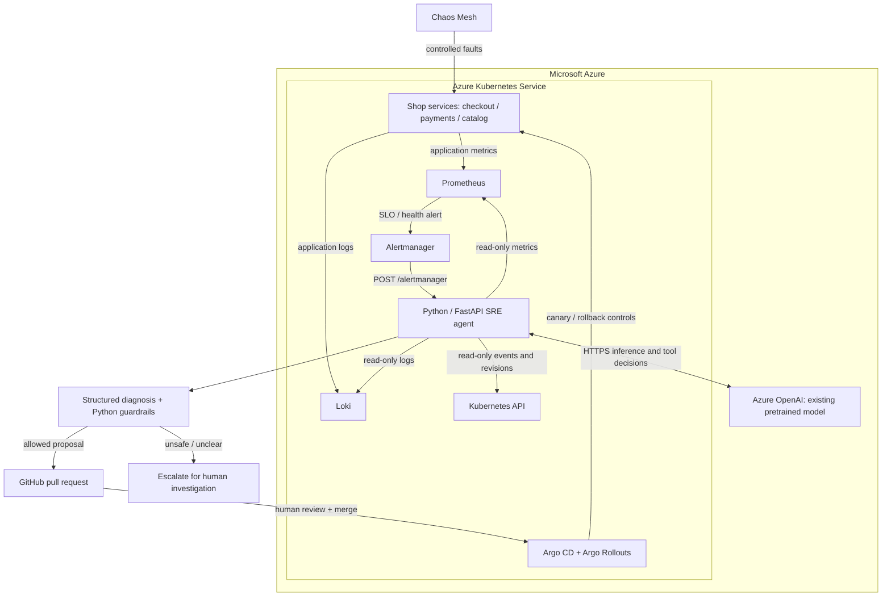
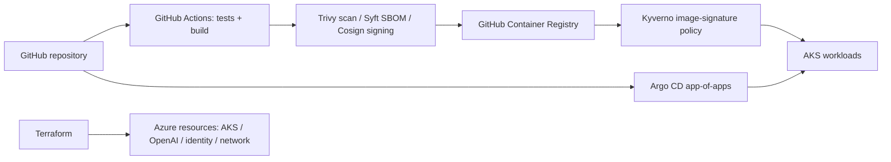
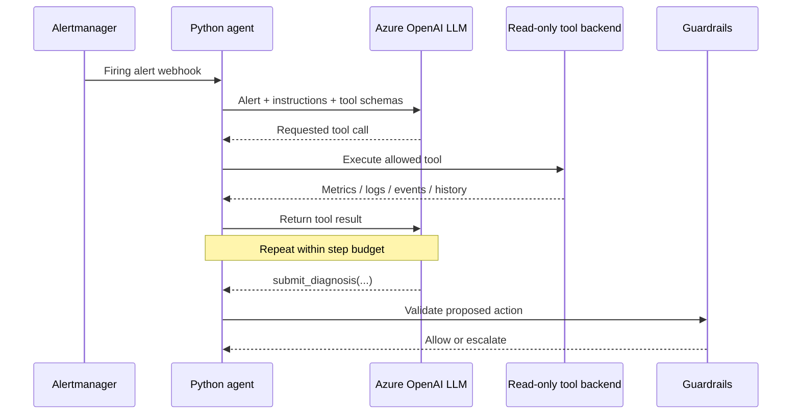

# AI-Powered SRE Agent for Azure Kubernetes Service

**Evidence-driven Kubernetes incident investigation with Azure OpenAI, read-only tools, policy guardrails, and human-approved GitOps remediation.**

[](https://azure.microsoft.com/) [](https://learn.microsoft.com/azure/aks/) [](agent/) [](infra/) [](gitops/)

> **Status:** Implemented and validated locally. Full Azure deployment, live incident runs, and LLM accuracy measurements have **not yet been verified**. See [Validation and project status](#validation-and-project-status).

## Contents

- [The problem and the solution](#the-problem-and-the-solution)
- [System architecture](#system-architecture)
- [End-to-end incident lifecycle](#end-to-end-incident-lifecycle)
- [Inside the AI agent](#inside-the-ai-agent)
- [Infrastructure and GitOps](#infrastructure-and-gitops)
- [Security and safety design](#security-and-safety-design)
- [Incident scenarios](#incident-scenarios)
- [Repository structure](#repository-structure)
- [Run and validate](#run-and-validate)
- [Validation and project status](#validation-and-project-status)
- [Design decisions and limitations](#design-decisions-and-limitations)

## The problem and the solution

Production alerts often describe a **symptom**, not its cause. A high checkout error rate might result from a broken deployment, resource exhaustion, or a failing payments dependency. An engineer typically has to correlate metrics, logs, events, deployments, and service health before deciding what to do.

This project implements a **human-in-the-loop SRE investigation platform** for a three-service demo shop (`checkout`, `payments`, `catalog`) running on Azure Kubernetes Service (AKS). Prometheus and Alertmanager detect incidents; a Python agent gathers evidence through five read-only tools; an existing LLM served through **Azure OpenAI** helps formulate a structured diagnosis; deterministic Python guardrails check proposed changes; and GitHub pull requests provide review before Argo CD and Argo Rollouts deliver an approved configuration change.

**Scope:** This is an application built around an existing pretrained model. It does **not** train or fine-tune an LLM. The LLM does not execute `kubectl`, modify AKS, or merge pull requests.

### Capabilities

| Capability | Implementation |
| --- | --- |
| Detect incidents | Prometheus alert rules and Alertmanager webhooks |
| Collect evidence | Metrics, Loki logs, Kubernetes warning events, deployment history, dependencies |
| Analyze | Azure OpenAI tool-calling loop with a structured diagnosis schema |
| Constrain risk | Policy checks on service scope, confidence, rollback tags, replica count, memory |
| Propose remediation | A small GitOps YAML change submitted as a GitHub PR when authorized |
| Deliver approved changes | Argo CD reconciliation and Argo Rollouts canary controls |
| Exercise failures | Chaos Mesh experiments and recorded evaluation fixtures |
| Validate platform | Tests, schema checks, PromQL validation, workflow linting, signing policy checks |

## System architecture

### 1. Runtime, investigation, and remediation



**Read the arrows carefully:** Alertmanager triggers the agent, but the LLM is **not** the monitoring system. The Python application executes tool calls and controls the workflow. Azure OpenAI supplies model inference. A merged Git change, not an LLM response, is what Argo CD reconciles into the cluster.

### 2. Delivery and platform supply chain



These diagrams describe the **implemented intended architecture**; end-to-end Azure operation remains to be demonstrated.

## End-to-end incident lifecycle

1. **An incident occurs.** A demo service becomes unhealthy or experiences latency, errors, or resource pressure.
2. **Prometheus detects the symptom.** An alert rule fires and Alertmanager posts the alert to the FastAPI endpoint `POST /alertmanager`.
3. **The server accepts and deduplicates it.** `server.py` skips repeated alert fingerprints within a 15-minute window and starts an investigation task.
4. **The agent collects evidence.** `agent.py` sends instructions and available tool definitions to the model. The model requests tools; Python runs those tools against Prometheus, Loki, and the Kubernetes API, then returns the results. The default limit is **eight model turns**, not necessarily eight tool calls.
5. **The model submits a diagnosis.** The `submit_diagnosis` function schema requires a category, root-cause hypothesis, confidence value, evidence, and proposed action.
6. **Guardrails validate the proposal.** `guardrails.py` applies hard limits. A rejected action becomes **escalate** rather than a configuration change.
7. **The agent prepares a GitOps change.** `remediation.py` edits the relevant `gitops/apps/<service>/values.yaml` setting and, if GitHub credentials are configured, opens a PR. Otherwise the system can record a dry-run proposal.
8. **A human reviews and merges.** Argo CD tracks `main` and reconciles the approved state. Argo Rollouts manages canary deployment and rollback behavior.

### Example: catalog pod runs out of memory

**Illustrative incident:** The catalog service repeatedly restarts with OOM-related warnings. The agent checks memory pressure, restart history, logs, and recent deployments. It may propose increasing the memory limit if evidence supports that action. The Python guardrail then verifies the new limit is within policy. If permitted, the agent proposes a one-field YAML change in a PR; it does **not** immediately resize the running pod. Increasing the limit may mitigate symptoms without fixing an underlying memory leak.

## Inside the AI agent

### Components and code ownership

| File | Responsibility |
| --- | --- |
| [`agent/src/sre_agent/server.py`](agent/src/sre_agent/server.py) | FastAPI webhook, incident records, deduplication, agent invocation, observability endpoints |
| [`agent/src/sre_agent/llm.py`](agent/src/sre_agent/llm.py) | Azure OpenAI client, authentication, request/response adapter, scripted test model |
| [`agent/src/sre_agent/agent.py`](agent/src/sre_agent/agent.py) | System prompt, bounded tool-calling loop, structured diagnosis |
| [`agent/src/sre_agent/tools.py`](agent/src/sre_agent/tools.py) | Tool definitions, safe dispatch, live and fixture backends, secret redaction |
| [`agent/src/sre_agent/mcp_server.py`](agent/src/sre_agent/mcp_server.py) | Exposes the same read-only tools to compatible MCP clients |
| [`agent/src/sre_agent/guardrails.py`](agent/src/sre_agent/guardrails.py) | Deterministic safety checks on suggested actions |
| [`agent/src/sre_agent/remediation.py`](agent/src/sre_agent/remediation.py) | Minimal GitOps values changes and GitHub PR creation |

### Tool-calling loop



The LLM chooses **which tool to request**, but **Python executes it**. The internal loop uses a Python backend directly; MCP is an additional interface exposing the same tools to other clients, not a mandatory network hop for each internal call.

### Five investigation tools

| Tool | What it retrieves | Why it matters |
| --- | --- | --- |
| `get_service_metrics` | Request rate, 5xx rate, p99 latency, CPU, memory, restarts, replicas | Establish severity and trends |
| `get_recent_logs` | Recent error messages from Loki | Identify exceptions and timeouts |
| `get_kubernetes_events` | Namespace warning events | Detect OOM, BackOff, scheduling issues |
| `get_deploy_history` | ReplicaSet revisions, image tags, timestamps | Correlate failures with releases |
| `get_dependencies` | Declared downstream dependencies and health | Separate upstream symptoms from downstream causes |

`tools.py` limits each tool result to 4,000 characters and applies pattern-based credential redaction before returning it to the model. Pattern-based redaction reduces exposure but cannot guarantee every possible secret is detected.

### Azure OpenAI integration

The application uses the OpenAI Python SDK's `AzureOpenAI` client when `AZURE_OPENAI_ENDPOINT` is configured. It reads the Azure deployment name from `AZURE_OPENAI_DEPLOYMENT`. Authentication supports an API key or Microsoft Entra credentials through `DefaultAzureCredential` (including AKS workload identity in the intended deployment).

The code calls `chat.completions.create(...)` with conversation messages and function-tool schemas. `tool_choice="required"` requires a tool call on each model turn; `submit_diagnosis` is the terminal structured tool. `temperature=0` requests more consistent output but **does not guarantee correctness**.

### Structured diagnoses and actions

A diagnosis includes an incident category, a concise root-cause hypothesis, a confidence score, concrete observations, and a proposed action. Supported remediation types include **rollback**, **scale**, **increase memory**, and **escalate**. The model's confidence score is self-reported, not a calibrated probability of correctness.

## Infrastructure and GitOps

### Azure provisioning

The deployment script [`scripts/up.sh`](scripts/up.sh) orchestrates prerequisite checks, Terraform state storage, Terraform provisioning, AKS access, Argo CD installation, and GitOps bootstrap. It checks regional model availability and compute quota before provisioning. Terraform manages the Azure infrastructure under [`infra/`](infra/).

The script's default model configuration is `gpt-4.1-mini` (version `2025-04-14`) unless overridden; availability depends on the chosen Azure region and subscription. Model names in examples are **not** a claim that a particular deployment already exists.

### GitOps app-of-apps

[`gitops/bootstrap/root-app.yaml`](gitops/bootstrap/root-app.yaml) defines a root Argo CD Application pointing at `gitops/argocd` on `main`. Argo CD then manages the child applications. A merged PR updating a service's Helm values becomes the desired state; Argo CD reconciles it, while Argo Rollouts supplies progressive-delivery controls.

This separation is deliberate: the AI agent has no Kubernetes write tool. **Git review is the approval boundary.**

### CI/CD and software supply chain

The repository's GitHub Actions workflows implement tests and container build steps, with scanning, SBOM generation, and signing tools. The intended cluster-side Kyverno policy checks image signatures. Static policy validation has been recorded, but a successful live signed-image deployment has not yet been verified.

## Security and safety design

| Control | Why it exists | Implementation |
| --- | --- | --- |
| Read-only investigation | Prevent destructive model-selected commands | Five allowlisted tools, no raw shell or `kubectl` |
| Scope restriction | Prevent changes to arbitrary services | `checkout`, `payments`, `catalog` allowlist |
| Confidence threshold | Reject low-confidence change proposals | Minimum model-reported `0.60` |
| Scaling ceiling | Bound capacity changes | At most `10` replicas, must exceed current capacity |
| Memory ceiling | Bound memory changes | At most `1024 MiB` and `2×` current limit per step |
| Rollback validation | Avoid arbitrary or nonexistent images | Must use previously deployed valid tag |
| Secret handling | Reduce accidental model exposure | Redaction before tool results reach model |
| Approval gate | Prevent unattended rollout | PR reviewed and merged by a human |
| Authentication | Avoid embedded long-lived model secrets | Entra/workload identity option |

**Operational caution:** This is a demonstration platform, not a production security certification. In-memory incident storage, model uncertainty, prompt-injection risk in logs, and availability of external services require further hardening for real production use.

## Incident scenarios

| Scenario | Failure injection | Expected diagnosis/action |
| --- | --- | --- |
| Payments outage | Payments becomes unavailable | Dependency failure; **escalate** and identify payments |
| Catalog memory exhaustion | Repeated OOMKilled events | Memory exhaustion; bounded increase recommendation |
| Checkout CPU saturation | CPU pressure with HPA at max | Capacity problem; increase allowed replica ceiling |
| Bad checkout deployment | Faulty `v1.4.0` release | Bad deployment; recommend known-good `v1.3.2` |
| Misleading deployment (recorded eval) | Errors precede unrelated release | Do **not** blame later deployment; escalate dependency failure |

The fifth case specifically tests whether the model confuses temporal proximity with causation.

## Repository structure

```text
aks-ai-sre-agent/
├── agent/                 # Agent, LLM adapter, tool backends, guardrails, MCP, evals
├── services/shop/         # Demo checkout, payments, catalog services
├── infra/                 # Terraform-managed Azure resources
├── gitops/                # Argo CD applications, Helm values, cluster configuration
├── chaos/                 # Chaos Mesh failure experiments
├── .github/workflows/     # CI and container supply-chain workflows
├── scripts/               # Provision, access UI, inject incident, teardown
└── README.md
```

## Run and validate

### Local agent tests (no Azure resources required)

```bash
cd agent
python3 -m venv .venv
source .venv/bin/activate
pip install -e ".[dev]"
pytest
sre-agent-evals evals/scenarios
```

The baseline evaluation does **not** measure LLM performance. To run the model-based evaluation, configure Azure OpenAI credentials and a supported deployment, then run:

```bash
sre-agent-evals evals/scenarios --agent --runs 3
```

### Full Azure demo (creates billable resources)

**Prerequisites:** Azure subscription and sufficient permissions/quota; Azure Cloud Shell (Bash); successful GitHub Actions image builds; publicly pullable `shop` and `sre-agent` packages in GHCR. GitHub PR creation additionally requires a suitable token; without it the agent can operate in dry-run mode.

```bash
git clone https://github.com/srujanachireddy/aks-ai-sre-agent.git
cd aks-ai-sre-agent
./scripts/up.sh
```

The script prompts for confirmation before provisioning. After deployment, restrict UI access to your laptop's public IP and test a scenario:

```bash
./scripts/ui.sh <your-laptop-ip>
./scripts/incident.sh payments
./scripts/incident.sh agent
```

**Always tear down the billable demo when finished:**

```bash
./scripts/down.sh
```

The previous project estimate was approximately **$0.40/hour** for a small environment; actual charges vary by subscription, region, resource sizes, and usage. Verify costs in Azure rather than treating the estimate as a guarantee.

## Validation and project status

The following results are **reported by the repository's existing local validation record**, not independently reproduced in this README update:

| Check | Recorded result |
| --- | --- |
| Agent unit tests (loop, guardrails, webhook, MCP, redaction, GitOps) | **30 passing** |
| Demo shop tests | **8 passing** |
| Azure OpenAI request/response integration | Verified against a **mock endpoint** |
| Rule-based baseline on five recorded incidents | **2/5 correct (40%)** |
| Terraform validation | Passed |
| Helm/Kubernetes schema checks | **37/37 valid** |
| PromQL queries | **19/19 valid** |
| Alert rules | Tested with `promtool` |
| Kyverno signing policy, chaos CRDs, workflows and scripts | Static/CLI validation recorded |

### Still to demonstrate

- [ ] Build and sign container images through GitHub Actions.
- [ ] Provision Azure resources and verify Argo CD applications are Synced/Healthy.
- [ ] Trigger and investigate all incident types live in AKS.
- [ ] Measure LLM agent accuracy across the recorded scenarios.
- [ ] Capture Grafana, Argo CD, incident diagnosis, and PR evidence.
- [ ] Update this README with observed results, screenshots, and measured limitations.

**Do not interpret the baseline's 40% accuracy as the LLM's accuracy.** Live LLM results have not yet been measured. No production MTTR improvement is claimed.

## Design decisions and limitations

**Why an LLM?** To reason across heterogeneous observations and suggest an evidence-based explanation, while recognizing that the explanation may be wrong.

**Why fixed read-only tools?** To limit privileges, keep the model's interface understandable, and make investigations reproducible against recorded fixtures.

**Why Python guardrails?** Safety-critical constraints should be checked deterministically rather than relying on the model to obey instructions.

**Why GitOps PRs instead of direct cluster changes?** They create a reviewable diff, approval point, and audit trail. Argo CD and Argo Rollouts handle deployment separately.

**What remains unproven?** End-to-end reliability in a live AKS environment, LLM diagnostic accuracy, and operational performance under real incident load. These are explicit next steps, not completed results.

---

**Portfolio focus:** Azure Platform Engineering · Kubernetes · Site Reliability Engineering · AIOps · Infrastructure as Code · Secure GitOps
